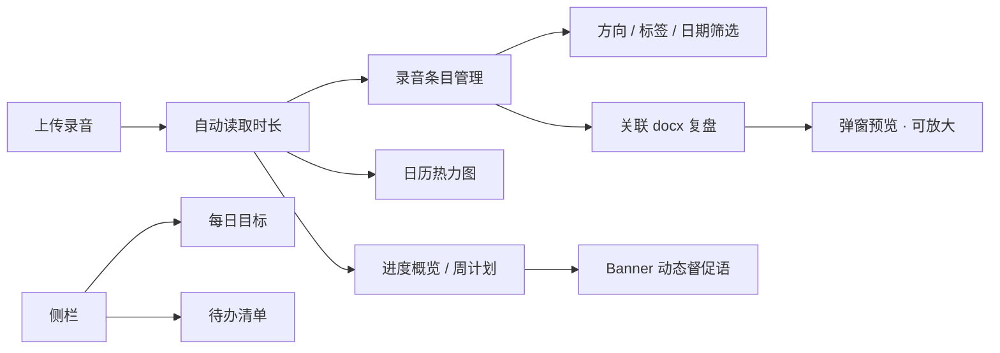

# 🎧 口译练习打卡 · 便利贴版


一个为口译学习者设计的**网页练习打卡工具**。上传录音即可自动统计时长、生成日历热力图、管理每日目标与待办，并可为每段录音关联 AI 生成的复盘文档。整体采用温暖的黄色便利贴视觉风格，纯前端实现，无需服务器、无需联网、无需注册。

> 🔗 **在线体验**：<https://linapple2288.github.io/interpreting-check/>
>
> 📦 **GitHub 仓库**：<https://github.com/LinApple2288/interpreting-check>

---

## 🎯 目标用户

| 用户群体 | 典型场景 |
|---------|---------|
| 口译专业本科生 / MTI 研究生 | 备考 CATTI、考研复试，需要长期量化练习量 |
| 口译自学者 | 脱离课堂，缺少监督，需要可视化进度维持动力 |
| 口译教师 / 助教（轻量使用） | 查看学生阶段性练习趋势，辅助个性化指导 |

核心画像：**有持续练习意愿，但缺乏追踪与反馈机制的口译学习者**。

---

## 😣 实际问题

1. **练了多少说不清**——录音散落在电脑各处，时长靠手动累加，进度全凭感觉。
2. **坚持不下去**——没有即时反馈和视觉激励，目标遥不可及，容易半途而废。
3. **练习质量无法回溯**——分不清哪段是英译中、哪段是中译英，更记不住当时的表现问题。
4. **复盘文档与录音脱节**——用 AI 工具生成了复盘报告，却无法与对应录音关联，翻阅困难。
5. **现有打卡工具太重**——需要注册、联网、付费，对个人学习者不友好。

---

## ✨ 功能一览



| 模块 | 说明 |
|-----|------|
| 🏠 Banner 督促区 | 卡通督促员形象 + 根据录音进度动态切换的标语 |
| ① 目标设置 | 设定总小时数、起止日期，支持个性化周期 |
| ② 进度概览 | 已录 / 剩余时长、剩余周数、每周需完成量、进度条 |
| ③ 上传录音 | 点击或拖拽上传，自动解析音频时长（精确到秒） |
| ④ 打卡热力图 | 月历视图，颜色深浅反映当日练习强度 |
| ⑤ 录音记录 | 编辑日期、翻译方向、表现标签，关联复盘文档 |
| 🎙️ 录音管理（侧栏） | 按语言类型 / 标签 / 日期范围筛选，查看总时长 |
| 📅 目标·待办（侧栏） | 本周每日目标追踪 + 待办清单（localStorage 持久化） |
| 📄 复盘预览 | 关联 WorkBuddy 生成的 .docx 文件，本地转换后弹窗预览 |

---

## 🚀 使用方法

### 1. 打开网页

访问 GitHub Pages 页面：<https://linapple2288.github.io/interpreting-check/>

无需安装任何环境，打开即用。数据保存在当前浏览器中。

### 2. 日常使用流程

1. 在「① 目标设置」填写总目标小时数与起止日期；
2. 把练习录音拖进「③ 上传录音」区域，系统自动识别时长；
3. 在录音条目中选择翻译方向（英译中 / 中译英）、填写表现标签；
4. 打开右侧栏「📅 目标 · 待办」查看本周每日目标，添加待办事项；
5. 在「🎙️ 录音管理」中按条件筛选，回顾特定类型练习；
6. 用 WorkBuddy 复盘 skill 生成 .docx 报告，点击录音条目的「📄 上传复盘」关联，点「👁 预览」查看，文档过大时可点「⤢ 放大」。

### 3. 数据说明

所有录音元数据、目标配置、待办与复盘文档均保存在**浏览器 localStorage**，不会上传到任何服务器。清除浏览器数据会导致本地记录丢失，重要数据请自行备份。

---

## 🤖 AI 工具

本项目的设计与开发过程中使用了以下 AI 能力：

| 工具 | 用途 |
|-----|------|
| **多模态内容生成（文生图）** | 生成 Banner 中的卡通督促员形象，与原参考图风格保持一致（黑发、圆框眼镜、耳机、向上指引手势） |
| **Python / PIL** | 对生成图片进行背景抠除、水印清理与边缘裁剪，得到透明 PNG 以融入页面 |
| **WorkBuddy / CodeBuddy 编程助手** | 完成全部 HTML / CSS / JavaScript 编码与多轮功能迭代 |
| **docx 技能** | 提供 .docx 文件结构解析与转换方案的技术参考，辅助选定本地预览实现路径 |
| **WorkBuddy 复盘 skill（用户侧）** | 用户将录音交由该 skill 生成 .docx 复盘报告，再通过半自动方式关联到本项目 |
| **mammoth.js**（开源库，非 AI） | 在浏览器本地将 .docx 转换为 HTML 实现预览，无需联网 |

> 说明：录音转写与 AI 自动复盘并非本项目内置功能。项目采用**半自动工作流**——由用户在本机 WorkBuddy 中完成复盘，再将结果文档导入页面，兼顾能力复用与本地隐私。

---

## 🗣️ 用户反馈与改进

以下内容整理自项目迭代过程中收集的真实使用反馈，每一条都直接推动了对应功能的落地。

### 反馈 1 · 用户 W（MATI 研究生）

> "页面一打开就是密密麻麻的表格，没有一点想练的冲动。我目标定的是 100 小时，但每次打开都忘了还差多少，能不能有个东西时不时督促我一下？"

**改进措施：**
- 生成卡通督促员插画并置于 Banner，与页面暖黄色便利贴风格统一；
- 新增**动态督促语**：未录音时提示"今天第一句，什么时候开录？"，录音不足 1 小时时提示"再加把劲，凑满 1 小时！"，超过 1 小时后提示"稳住节奏，向目标冲刺！"；
- 标语中的目标小时数与「目标设置」实时联动，修改目标后 Banner 自动同步。

---

### 反馈 2 · 用户 M（MASI 研究生）

> "录音一多就乱，分不清哪段是英译中、哪段是中译英，也不记得哪段表现有问题。侧栏东西堆在一起，找个筛选要滚半天，右上角那个圆按钮也不太好点。"

**改进措施：**
- 录音条目新增**翻译方向**下拉（英译中 / 中译英）与**自定义表现标签**输入框；
- 时长显示改为 `时:分:秒` 格式，精确到秒；
- 侧栏重构为两个 Tab：**「📅 目标 · 待办」**（每日目标与待办同列）和 **「🎙️ 录音管理」**（独立分区）；
- 录音管理支持语言类型、标签、日期范围三维筛选，默认显示全部时间，并可一键重置；
- 右上角圆形按钮改为**屏幕边缘竖向图标把手**，展开/收起更顺手；
- 录音记录与复盘文档纳入 localStorage 持久化，刷新不丢失。

---

### 反馈 3 · 用户 L（MASI 研究生）

> "我让 AI 帮我复盘生成了 Word 文档，但没法跟具体录音对上号。想在页面里直接看。"

**改进措施：**
- 每条录音支持**关联 .docx 复盘文档**，可更换、移除，删除录音时一并清理；
- 引入本地 mammoth.js，在浏览器内将 docx 转为 HTML **弹窗预览**，保留标题、表格等结构，完全离线；
- 侧栏录音列表中，带复盘的条目显示「📄 复盘」标记，可直接跳转预览。

---

## 📁 文件结构

```
.
├── index.html                  # 主页面（HTML + CSS + JavaScript 单文件）
├── banner-cutout.png           # Banner 插画（透明背景，页面实际使用）
├── banner-illustration.png     # 插画原图（保留存档）
├── mammoth.browser.min.js      # 本地 docx 预览依赖
└── README.md                   # 本文档
```

---

## 🔧 技术栈

- **HTML5 / CSS3**：响应式布局、便利贴视觉风格、Tab 分区、模态弹窗
- **原生 JavaScript**：状态管理、localStorage 持久化、音频元数据读取、筛选逻辑
- **Web Audio API**：`audio` 元素读取录音时长
- **mammoth.js**：浏览器端 docx → HTML 转换
- **零依赖后端**：纯静态页面，可直接部署至 GitHub Pages

---

## 📄 许可

本项目仅供个人学习与本地非商业使用。插画由 AI 生成，仅供本项目演示。
